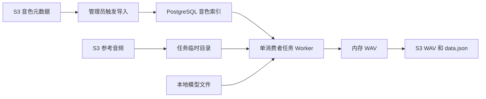

# S3 音色资源与 PostgreSQL 索引

ZVox 使用 S3 保存音色元数据, 参考音频, 头像和生成结果, 使用 PostgreSQL 保存用户, 会话, 音色索引和任务状态. 服务实例只需保留模型目录和可写临时空间.

## 数据分工

| 数据 | 保存位置 | 读取方式 |
| --- | --- | --- |
| 音色元数据 | S3 中的 `vox-data.json`, PostgreSQL 中的 `speakers` 索引 | 管理员导入 S3 元数据后, 查询与任务执行读取数据库 |
| 参考音频 | S3 | 每个任务按需下载到独立临时目录 |
| 头像 | S3 | 查询接口生成预签名 GET URL, 浏览器直接访问 |
| 输出音频与元数据 | S3 中的 WAV 和 `data.json` | PostgreSQL 保存结果对象 key, 查询时生成预签名 URL |
| 用户与会话 | PostgreSQL 的 `users`, `sessions` | 账号管理和 Bearer Token 鉴权 |
| 任务状态 | PostgreSQL 的 `jobs` | 任务查询, 额度检查和启动恢复 |
| 模型 | `MODEL_PATH` 本地目录 | 按需加载, 空闲后卸载 |

S3 中的输出 `data.json` 不包含完整用户, 会话和任务状态, 不能替代 PostgreSQL. 启动时初始化数据库表和索引, 并恢复待处理及中断的任务.

## 资源流程



服务不依赖持久的 `speaker/` 目录, 也不在本地与 S3 之间执行双向文件同步.

## 创建与发布音色

管理员可在网页中上传参考音频或录音创建音色. [speaker.py](../app/services/speaker.py) 校验音频内容, 转为单声道 PCM WAV, 上传参考音频和 `vox-data.json`, 再写入 PostgreSQL. 保存成功后音色立即对所有用户可用. 保存过程中元数据或数据库写入失败时, 服务尝试删除已上传的对象.

通过 S3 管理端发布资源时:

1. 将参考音频和可选头像上传到对应音色的前缀.
2. 上传引用这些对象的 `vox-data.json`.
3. 调用 `POST /api/admin/speakers/sync`, 或在系统管理页面触发导入.
4. 查询 `GET /api/admin/speakers/sync/status`, 检查 `imported`, `deleted` 和 `errors`.

元数据格式与上传限制见 [API 文档](api.md#speaker-对象结构). 音频和头像字段使用桶内完整对象 key, 支持 `{id}` 占位符. 展开后的 key 必须属于对应音色的前缀, 不接受 URL, 本地绝对路径或 `..` 路径组件.

## 元数据导入

[sync.py](../app/services/sync.py) 分页列举 `S3_SPEAKER_PREFIX`, 读取 `{id}/vox-data.json`, 完整校验后在一个 PostgreSQL 事务中更新和删除音色索引.

- JSON 中的 ID 必须是正整数, 与对象路径中的音色 ID 一致, 且不能重复.
- 名称和语音配置必填, 音频和头像对象 key 通过统一的前缀校验.
- 列举或读取失败, JSON 无效或没有元数据时, 保留现有索引并报告错误.
- 只有全部元数据导入成功后, 才删除 S3 中已撤下的音色索引.
- 导入不下载完整音频或头像, 也不上传本地文件.

上传音色和导入索引共用进程内写入锁. 导入校验元数据和对象 key, 不检查每个引用音频能否实际下载; 缺失或不可访问的音频会使对应生成任务失败.

音色查询始终读取 PostgreSQL. S3 中修改 JSON 后需要重新导入, 才会更新查询和后续任务使用的配置. 当前任务执行时读取最新音色配置, 不保存提交时的资源快照; 排队期间撤下音色可能导致任务失败.

## 推理输入与输出

[tts.py](../app/services/tts.py) 为每个任务创建独立临时目录, 下载 `prompt_wav_path` 和 `reference_wav_path` 引用的对象, 将本地路径传给模型. 同一任务引用同一个 key 时只下载一次, 两个不同 key 使用不同临时文件. 临时目录在任务执行结束后清理.

模型从 `MODEL_PATH` 加载, 需要本地配置和权重文件. 参考音频和模型路径均使用本地加载入口, 不能直接替换为 S3 URL. 模型准备与离线运行方式见 [部署文档](deployment.md).

输出音频通过 `BytesIO` 编码为 WAV 并上传, 无需持久输出目录. 默认结果布局为:

```text
output/{job_id}/{job_id}.wav
output/{job_id}/data.json
```

WAV 和 `data.json` 均上传成功后, 才将任务标记为 `completed`. 上传失败时尝试清理输出对象, 任务标记为 `failed` 并记录错误. 数据库保存结果对象 key, 查询任务时生成有效期由 `PRESIGNED_EXPIRES_IN` 控制的 URL.

## 部署与验证

AWS S3 和 RustFS 均通过 [S3 客户端](../app/core/s3.py) 访问, 头像和结果音频统一使用预签名 URL. 浏览器需能直接访问返回的存储地址; HTTPS 页面使用 HTTPS 存储地址. 配置项见 [README](../README.md#对象存储).

部署维持一个服务实例和一个 Uvicorn Worker, 进程内队列和锁不协调多实例. PostgreSQL 需要独立持久保存, 模型目录持久保存, 系统临时目录可写.

后端回归覆盖音色上传, 元数据分页导入, 无效元数据保留索引, 对象 key 校验, 参考音频下载复用, 输出上传失败及临时资源清理. 数据库测试使用 PostgreSQL 独立随机 Schema, S3 与模型使用测试替身.

真实 S3 访问, 模型加载和生成音频需在目标环境验证. 就绪检查只覆盖 PostgreSQL, 模型文件完整性和后台 Worker 存活.
